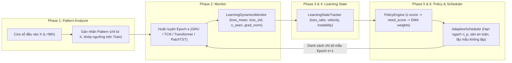

# PALF — Pattern-Aware Learning Framework

**PALF (Pattern-Aware Learning Framework)** là một khung huấn luyện thích nghi độc lập kiến trúc (*model-agnostic adaptive training framework*) dành cho bài toán dự báo chuỗi thời gian (*time-series forecasting*).

Thay vì đối xử đồng đều với mọi cửa sổ thời gian trong suốt quá trình huấn luyện (như cách lấy mẫu ngẫu nhiên truyền thống `DataLoader(shuffle=True)`), PALF tự động phân loại các cửa sổ đầu vào thành các **Pattern** có ý nghĩa vật lý, theo dõi **động lực học (Learning Dynamics)** của từng Pattern sau mỗi epoch, và điều chỉnh **tỷ lệ lấy mẫu theo Pattern (reweighting & sample budgeting)** ở các epoch tiếp theo.

---

## 1. Động lực & Bài toán (Motivation)

Trong dữ liệu chuỗi thời gian thực tế (như bộ dữ liệu khí tượng **Jena Climate 2009–2016**):
- Khoảng **73.8%** số cửa sổ thời gian thuộc trạng thái thời tiết bình thường (`normal`), trong khi các hiện tượng biến động mạnh hoặc cực đoan như **sụt áp nhanh** (`pressure_drop`), **độ ẩm tăng đột ngột** (`humidity_net_rise`), và **dị thường nhiệt độ nóng/lạnh** (`temp_anomaly`) chỉ chiếm từ **7% – 10%** mỗi loại.
- Khi huấn luyện đồng đều (*uniform sampling*), các mẫu `normal` áp đảo gradient và hội tụ sớm, trong khi các Pattern hiếm/biến động có tốc độ giảm lỗi và độ bất ổn khác biệt rõ rệt theo từng giai đoạn huấn luyện.
- **Mục tiêu của PALF:** Đóng vòng phản hồi tự động sau mỗi epoch để phân bổ lại ngân sách mẫu huấn luyện về các Pattern đang cần học hơn, giúp:
  1. **Cùng ngân sách mẫu ($\rho = 1.0$):** Kiểm tra khả năng cải thiện chất lượng dự báo trên các Pattern khó.
  2. **Giảm ngân sách mẫu ($\rho < 1.0$, ví dụ $\rho = 0.7$):** Duyệt ít mẫu hơn mỗi epoch (giảm thời gian huấn luyện) nhưng giữ hoặc vượt chất lượng của baseline lấy mẫu đều ở cùng ngân sách.

---

## 2. Kiến trúc 6 giai đoạn của PALF



### Chi tiết từng thành phần:
1. **Phase 1 — Pattern Analyzer (`src/palf/data/patterns_weather.py`)**:
   - Gán nhãn mỗi cửa sổ hoàn toàn dựa trên chuỗi quá khứ đầu vào $X$ ($L=96$ giờ), **tuyệt đối không nhìn chuỗi mục tiêu tương lai $Y$** ($H=24$ giờ).
   - Mọi ngưỡng phân vị và đường cơ sở theo mùa × giờ trong ngày được ước lượng **chỉ trên tập `train`**, kèm khoảng đệm `purge_gap = L + H - 1 = 119` bước giữa `train` / `val` / `test` để triệt tiêu rò rỉ cửa sổ trượt.
   - Bốn nhãn Pattern theo thứ tự ưu tiên phân cấp:
     1. `pressure_drop`: Sụt áp suất khí quyển mạnh trong 24h cuối cửa sổ.
     2. `humidity_net_rise`: Độ ẩm tương đối tăng ròng mạnh kèm mức ẩm cuối cửa sổ cao.
     3. `temp_anomaly`: Nhiệt độ lệch mạnh so với trung vị lịch sử cùng tháng & giờ (lưu kèm dấu `temp_sign = +1` cho dị thường nóng `heat` và `-1` cho dị thường lạnh `cold`).
     4. `normal`: Các cửa sổ còn lại.

2. **Phase 2 — Learning Dynamics Monitor (`src/palf/core/monitor.py`)**:
   - Ghi nhận ma trận lỗi từng mẫu qua các epoch (`sample_loss_epochs.npy` kích thước $N_{\text{train}} \times E$), số lượng mẫu thực sự được duyệt `n_seen`, độ lớn gradient (`grad_norm`) trên tập probe cố định, và bản đồ dữ liệu Dataset Cartography (`cartography.csv`).

3. **Phase 3 — Phân tích Thống kê & Kiểm định Dự báo (`src/palf/evaluation/phase3_analysis.py`)**:
   - Chuẩn hóa lỗi theo từng Pattern ở epoch đầu: $\tilde{\ell}_p(e) = \ell_p(e) / \ell_p(1)$ để khử chênh lệch thang đo biên độ tự nhiên giữa các Pattern.
   - Kiểm định Kruskal-Wallis và hiệu ứng $\epsilon^2$ trên đơn vị **đoạn sự kiện liên tiếp (*contiguous event runs*)** để tránh phóng đại cỡ mẫu giả tạo do các cửa sổ trượt chồng lấn.
   - Đối chứng với **nhóm hoán vị nhãn theo khối (*block-permutation null control*)** và kiểm định khả năng dự báo $\Delta\text{loss}(e \to e+k)$ vượt trên mô hình tự hồi quy chỉ dùng loss hiện tại.

4. **Phase 4 — Learning State Tracker (`src/palf/core/state.py`)**:
   - Tính toán trạng thái học cho từng Pattern chỉ từ thống kê **train** (chặn mọi khóa chứa `val` hoặc `test`):
     - `loss_ratio`: $\tilde{\ell}_p(e) = \ell_p(e) / \ell_p(1)$ (tỷ lệ lỗi còn lại so với epoch 1).
     - `velocity`: $(\tilde{\ell}_p(e-W) - \tilde{\ell}_p(e)) / W$ (tốc độ giảm lỗi trong cửa sổ $W$ epoch).
     - `instability`: $\text{std}(\tilde{\ell}_p(e-W+1 \dots e))$ (độ dao động của đường cong lỗi trong cửa sổ $W$).

5. **Phase 5 — Policy Engine (`src/palf/core/policy.py`)**:
   - Hỗ trợ 3 chế độ chính sách để đối chứng công bằng:
     - `uniform`: Mọi $w_p = 1.0$ (baseline đi qua Scheduler).
     - `loss`: Điểm ưu tiên chỉ dùng $z(\text{loss\_ratio})$ (đối chứng thích nghi đơn giản B2).
     - `state` (PALF): Kết hợp đa biến $N_p(e) = \sum_k s_k \cdot z_k(p, e)$ với dấu $s_k$ được xác nhận từ hồi quy Phase 3 (`loss_ratio: +1.0, velocity: +1.0, instability: +0.5`).
   - Chuyển điểm thành trọng số có cắt ngưỡng $[w_{\min}, w_{\max}]$ và làm mượt EMA theo thời gian:
     $$w_{\text{new}, p} = \text{clip}(1 + \alpha \cdot N_p(e),\; w_{\min},\; w_{\max}), \quad w_p(e) = \beta\, w_p(e-1) + (1-\beta)\, w_{\text{new}, p}$$

6. **Phase 6 — Adaptive Scheduler (`src/palf/training/scheduler.py`)**:
   - Với ngân sách $n_e = \text{round}(\rho \cdot n_{\text{train}})$ mẫu mỗi epoch:
     - Tính tỷ lệ mục tiêu $q_p \propto w_p \cdot \pi_p$ (với $\pi_p = N_p / n_{\text{train}}$).
     - Phân bổ hạn ngạch $n_p = \min(N_p, \text{round}(n_e \cdot q_p))$, bảo đảm sàn tối thiểu $n_{\text{floor}} = \min(N_p, \max(32, \text{round}(0.05 \cdot \pi_p \cdot n_e)))$ để không Pattern hiếm nào bị mất tín hiệu, và chia lại phần dư để $\sum_p n_p = n_e$.
     - Lấy mẫu ngẫu nhiên **không lặp** trong từng Pattern rồi gộp và xáo trộn toàn cục.

---

## 3. Các kiến trúc Backbone được hỗ trợ

PALF tách biệt hoàn toàn với kiến trúc mạng dự báo. Dự án tích hợp sẵn 4 họ kiến trúc tiêu biểu trong [`src/palf/models/`](file:///d:/Github/PALF/src/palf/models/__init__.py):

| Tên Backbone | Mã CLI (`--model`) | Họ kiến trúc | Đặc trưng chính |
|---|---|---|---|
| **GRU** | `gru` | Recurrent (RNN) | Mạng hồi quy có cổng 2 tầng, xử lý tuần tự theo bước thời gian |
| **TCN** | `tcn` | Convolutional | Mạng tích chập nhân quả giãn nở (*dilated causal convolution*) kèm kết nối tắt |
| **Transformer** | `transformer` | Attention (Step-wise) | Mã hóa vị trí + Multi-Head Self-Attention trên từng bước thời gian |
| **PatchTST** | `patchtst` | Patch-based Transformer | Chia chuỗi thành các đoạn ngắn (*patches*) trước khi đưa vào Transformer |

---

## 4. Cấu trúc thư mục dự án

```text
PALF/
├── app/
│   └── app.py                          # Giao diện Demo Streamlit (3 trang: So sánh, Quan sát PALF, Train trực tiếp)
├── data/
│   └── raw/                            # Thư mục tự động tải dữ liệu Jena Climate 2009-2016
├── experiments/
│   ├── analysis/
│   │   ├── phase3_real/                # Báo cáo & CSV phân tích Phase 3 trên 20 run Baseline thật (G3)
│   │   └── comparison/                 # Báo cáo, CSV & biểu đồ so sánh Baseline vs PALF (Mục 7)
│   ├── results/
│   │   ├── baseline/jena/              # Kết quả chạy Baseline A0 (<model>/seed<k>/)
│   │   └── palf/jena/                  # Kết quả chạy PALF (<config_tag>/<model>/seed<k>/)
│   └── scripts/
│       ├── run_observation.py          # CLI huấn luyện Baseline & PALF trên Jena / Synthetic
│       ├── analyze_phase3.py           # CLI chạy phân tích thống kê Phase 3
│       ├── compare_runs.py             # CLI chạy giao thức so sánh công bằng Mục 7 (A0, A0r, A1, A2, A2r)
│       └── run_pattern_audit.py        # CLI kiểm toán chất lượng Pattern Analyzer v1
├── src/palf/
│   ├── core/
│   │   ├── config.py                   # Lớp cấu hình trung tâm PalfConfig
│   │   ├── monitor.py                  # LearningDynamicsMonitor & Dataset Cartography
│   │   ├── state.py                    # LearningStateTracker (chỉ nhận tín hiệu train)
│   │   └── policy.py                   # PolicyEngine & PolicyDecision (uniform, loss, state)
│   ├── data/
│   │   ├── pattern_features.py         # Tiền xử lý chuỗi giờ & chia tập train/val/test có purge gap
│   │   ├── patterns_weather.py         # Pattern Analyzer v1 (4 nhãn thời tiết + temp_sign)
│   │   ├── weather.py                  # DataLoader cho Jena Climate
│   │   └── synthetic.py                # Bộ sinh dữ liệu chuỗi thời gian giả lập có kiểm soát
│   ├── evaluation/
│   │   ├── phase3_analysis.py          # Công cụ kiểm định thống kê & dự báo Phase 3
│   │   ├── demo_loader.py              # Bộ đọc và tổng hợp dữ liệu cho giao diện Demo
│   │   └── compare_runs.py             # Bộ tổng hợp giao thức so sánh công bằng Mục 7
│   ├── models/                         # Định nghĩa 4 mô hình: GRU, TCN, Transformer, PatchTST
│   └── training/
│       ├── scheduler.py                # AdaptiveScheduler (phân bổ hạn ngạch & lấy mẫu không lặp)
│       └── trainer.py                  # Vòng lặp huấn luyện hợp nhất (mode="baseline" | "palf")
└── tests/                              # 67 bài kiểm thử tự động (pytest)
```

---

## 5. Hướng dẫn cài đặt & Sử dụng nhanh (PowerShell)

### 5.1. Cài đặt môi trường
```powershell
python -m venv .venv
.\.venv\Scripts\Activate.ps1
pip install -e .
pip install pytest
```

### 5.2. Chạy bộ kiểm thử tự động (`pytest`)
Toàn bộ 67 bài kiểm thử kiểm tra từ chống rò rỉ dữ liệu, tính tất định của Pattern Analyzer, Monitor, Phase 3, Policy, Scheduler đến giao thức so sánh:
```powershell
.\.venv\Scripts\python.exe -m pytest -q
```

### 5.3. Mở giao diện Demo trực quan (Streamlit)
Giao diện gồm 3 trang:
1. **So sánh cạnh nhau (Ngoại tuyến):** Đặt 2–3 lần chạy sẵn trên đĩa cạnh nhau, vẽ đường `val_loss` theo **số mẫu tích lũy** và **thời gian tích lũy**, bảng MAE/RMSE (°C) tổng và theo từng Pattern, số mẫu & thời gian đạt ngưỡng `val_target`.
2. **Quan sát PALF:** Hiển thị trọng số `weights[p]`, tỷ lệ mẫu thực sự được duyệt (`n_seen` share) và các biến Learning State theo từng epoch.
3. **Huấn luyện trực tiếp (Quy mô nhỏ):** Chạy thử nghiệm nhanh trên tập con dữ liệu với tối đa 4 kết quả lưu đồng thời trên màn hình.

```powershell
.\.venv\Scripts\python.exe -m streamlit run app\app.py
```

### 5.4. Chạy huấn luyện qua CLI (`run_observation.py`)
5 cấu hình tiêu chuẩn trong giao thức thực nghiệm:
- **A0 (Baseline đầy đủ, $\rho=1.0$):**
  ```powershell
  .\.venv\Scripts\python.exe experiments\scripts\run_observation.py --model gru --mode baseline --seeds 0,1,2,3,4 --epochs 30
  ```
- **A0r (Đối chứng lấy mẫu đều qua Scheduler ở ngân sách giảm $\rho=0.7$):**
  ```powershell
  .\.venv\Scripts\python.exe experiments\scripts\run_observation.py --model gru --mode palf --policy uniform --budget-ratio 0.7 --seeds 0,1,2 --epochs 30
  ```
- **A1 (Đối chứng thích nghi chỉ dùng `loss_ratio`, $\rho=1.0$):**
  ```powershell
  .\.venv\Scripts\python.exe experiments\scripts\run_observation.py --model gru --mode palf --policy loss --budget-ratio 1.0 --alpha 1.0 --seeds 0,1,2 --epochs 30
  ```
- **A2 (PALF đa biến `state`, cùng ngân sách $\rho=1.0$):**
  ```powershell
  .\.venv\Scripts\python.exe experiments\scripts\run_observation.py --model gru --mode palf --policy state --budget-ratio 1.0 --alpha 1.0 --seeds 0,1,2 --epochs 30
  ```
- **A2r (PALF đa biến `state`, giảm ngân sách $\rho=0.7$):**
  ```powershell
  .\.venv\Scripts\python.exe experiments\scripts\run_observation.py --model gru --mode palf --policy state --budget-ratio 0.7 --alpha 1.0 --seeds 0,1,2 --epochs 30
  ```
*(Mẹo: Thêm `--subset 2048 --epochs 10` khi muốn chạy thử nghiệm nhanh trên máy cá nhân).*

### 5.5. Chạy phân tích Phase 3 và tổng hợp so sánh Mục 7
- **Phân tích Phase 3 trên log Baseline thật:**
  ```powershell
  .\.venv\Scripts\python.exe experiments\scripts\analyze_phase3.py --results-root experiments\results\baseline\jena --out-dir experiments\analysis\phase3_real
  ```
- **So sánh các cấu hình Baseline vs PALF (`A0, A0r, A1, A2, A2r`):**
  ```powershell
  .\.venv\Scripts\python.exe experiments\scripts\compare_runs.py --models gru,tcn,transformer,patchtst --seeds 0,1,2,3,4 --out-dir experiments\analysis\comparison
  ```

---

## 6. Nguyên tắc thực nghiệm bất biến (Experimental Integrity)

1. **Không rò rỉ tương lai hay tập đánh giá:**
   - Gán nhãn Pattern chỉ dùng cửa sổ quá khứ $X$, mọi thống kê chuẩn hóa và ngưỡng phân vị chỉ khớp trên `train`.
   - `LearningStateTracker` và `PolicyEngine` chỉ nhận thống kê từ tập `train`; tập `val` chỉ dùng để chọn checkpoint và tính ngưỡng hội tụ; tập `test` chỉ đánh giá một lần ở cuối.
2. **Đơn vị đo lường có ý nghĩa vật lý:**
   - Bên cạnh MSE/MAE/RMSE trên miền chuẩn hóa, mọi báo cáo và giao diện đều quy đổi sang đơn vị thực tế **độ C (°C)** tổng thể và tách theo từng Pattern (bao gồm cả tách `temp_anomaly` thành `temp_anomaly_heat` và `temp_anomaly_cold`).
3. **Trung thực thống kê:**
   - Đối chứng giảm ngân sách (`A2r`) luôn phải so trực tiếp với baseline lấy mẫu đều ở **cùng ngân sách** (`A0r`), không chỉ so với `A0`.
   - Với các cấu hình có ít hơn 5 seed, báo cáo chỉ mô tả xu hướng và hiệu số ghép theo từng seed (*paired seed differences*), không tuyên bố ý nghĩa thống kê.
