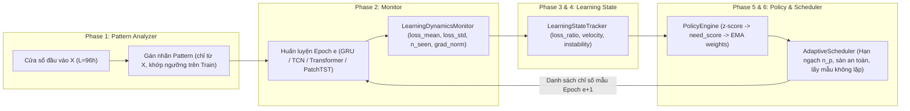

# PALF — Pattern-Aware Learning Framework

> **Phiên bản đóng băng Demo (`30/11`):** Tag **`v1.0-demo`** · Commit **`23794be`** (`23794bea3368b9004903973a98a7b53769149f55`, kế thừa kết quả thực nghiệm đóng băng tại `2c838ed`). Xem [`experiments/FREEZE_REPORT.md`](file:///d:/Github/PALF/experiments/FREEZE_REPORT.md) và [`experiments/DEMO_CHECK.md`](file:///d:/Github/PALF/experiments/DEMO_CHECK.md).

**PALF (Pattern-Aware Learning Framework)** là một khung huấn luyện thích nghi độc lập kiến trúc (*model-agnostic adaptive training framework*) dành cho bài toán dự báo chuỗi thời gian (*time-series forecasting*).

Thay vì đối xử đồng đều với mọi cửa sổ thời gian trong suốt quá trình huấn luyện (như cách lấy mẫu ngẫu nhiên truyền thống `DataLoader(shuffle=True)`), PALF tự động phân loại các cửa sổ đầu vào thành các **Pattern** có ý nghĩa vật lý, theo dõi **động lực học (Learning Dynamics)** của từng Pattern sau mỗi epoch, và điều chỉnh **tỷ lệ lấy mẫu theo Pattern (reweighting & sample budgeting)** ở các epoch tiếp theo.

---

## 1. Động lực & Bài toán (Motivation)

Trong dữ liệu chuỗi thời gian thực tế (như bộ dữ liệu khí tượng **Jena Climate 2009–2016** với `n_train = 48,981`, `n_val = 10,377`, `n_test = 10,377`):
- Trên tập test (`10,377` mẫu), trạng thái thời tiết bình thường (`normal`) chiếm **66,9%** (`6,942` mẫu), trong khi 3 nhóm biến động theo ngưỡng phân vị gồm **dị thường nhiệt độ nóng/lạnh** (`temp_anomaly`, **16,7%**, `1,730` mẫu), **sụt áp nhanh** (`pressure_drop`, **9,0%**, `929` mẫu), và **độ ẩm tăng ròng mạnh** (`humidity_net_rise`, **7,5%**, `776` mẫu).
- Khi huấn luyện đồng đều (*uniform sampling*), các mẫu `normal` áp đảo gradient và hội tụ sớm, trong khi các Pattern hiếm/biến động có tốc độ giảm lỗi và độ bất ổn khác biệt rõ rệt theo từng giai đoạn huấn luyện.
- **Mục tiêu của PALF:** Đóng vòng phản hồi tự động sau mỗi epoch để phân bổ lại ngân sách mẫu huấn luyện về các Pattern đang cần học hơn, giúp:
  1. **Cùng ngân sách mẫu ($\rho = 1.0$):** Kiểm tra khả năng cải thiện chất lượng dự báo trên các Pattern khó.
  2. **Giảm ngân sách mẫu ($\rho < 1.0$, ví dụ $\rho = 0.7$):** Duyệt ít mẫu hơn mỗi epoch (giảm thời gian huấn luyện) nhưng giữ hoặc vượt chất lượng của baseline lấy mẫu đều ở cùng ngân sách.

---

## 2. Kiến trúc 6 giai đoạn của PALF



### Chi tiết từng thành phần:
1. **Phase 1 — Pattern Analyzer (`src/palf/data/patterns_weather.py`)**:
   - Gán nhãn mỗi cửa sổ hoàn toàn dựa trên chuỗi quá khứ đầu vào $X$ ($L=96$ giờ), **tuyệt đối không nhìn chuỗi mục tiêu tương lai $Y$** ($H=24$ giờ).
   - Mọi ngưỡng phân vị và đường cơ sở theo mùa × giờ trong ngày được ước lượng **chỉ trên tập `train`**, kèm khoảng đệm `purge_gap = L + H - 1 = 119` bước giữa `train` / `val` / `test` để triệt tiêu rò rỉ cửa sổ trượt.
   - Bốn nhãn Pattern theo thứ tự ưu tiên phân cấp:
     1. `pressure_drop`: Sụt áp suất khí quyển mạnh trong 24h cuối cửa sổ.
     2. `humidity_net_rise`: Độ ẩm tương đối tăng ròng mạnh kèm mức ẩm cuối cửa sổ cao.
     3. `temp_anomaly`: Nhiệt độ lệch mạnh so với trung vị lịch sử cùng tháng & giờ (lưu kèm dấu `temp_sign = +1` cho dị thường nóng `heat` và `-1` cho dị thường lạnh `cold`).
     4. `normal`: Các cửa sổ còn lại.

2. **Phase 2 — Learning Dynamics Monitor (`src/palf/core/monitor.py`)**:
   - Ghi nhận ma trận lỗi từng mẫu qua các epoch (`sample_loss_epochs.npy` kích thước $N_{\text{train}} \times E$), số lượng mẫu thực sự được duyệt `n_seen`, độ lớn gradient (`grad_norm`) trên tập probe cố định, và bản đồ dữ liệu Dataset Cartography (`cartography.csv`).

3. **Phase 3 — Phân tích Thống kê & Kiểm định Dự báo (`src/palf/evaluation/phase3_analysis.py`)**:
   - Chuẩn hóa lỗi theo từng Pattern ở epoch đầu: $\tilde{\ell}_{p}(e) = \ell_{p}(e) / \ell_{p}(1)$ để khử chênh lệch thang đo biên độ tự nhiên giữa các Pattern.
   - Kiểm định Kruskal-Wallis và hiệu ứng $\epsilon^2$ trên đơn vị **đoạn sự kiện liên tiếp (*contiguous event runs*)** để tránh phóng đại cỡ mẫu giả tạo do các cửa sổ trượt chồng lấn.
   - Đối chứng với **nhóm hoán vị nhãn theo khối (*block-permutation null control*)** và kiểm định khả năng dự báo $\Delta\text{loss}(e \to e+k)$ vượt trên mô hình tự hồi quy chỉ dùng loss hiện tại.

4. **Phase 4 — Learning State Tracker (`src/palf/core/state.py`)**:
   - Tính toán trạng thái học cho từng Pattern chỉ từ thống kê **train** (chặn mọi khóa chứa `val` hoặc `test`):
     - `loss_ratio`: $\tilde{\ell}_{p}(e) = \ell_{p}(e) / \ell_{p}(1)$ (tỷ lệ lỗi còn lại so với epoch 1).
     - `velocity`: $(\tilde{\ell}_{p}(e-W) - \tilde{\ell}_{p}(e)) / W$ (tốc độ giảm lỗi trong cửa sổ $W$ epoch).
     - `instability`: $\text{std}(\tilde{\ell}_{p}(e-W+1 \dots e))$ (độ dao động của đường cong lỗi trong cửa sổ $W$).

5. **Phase 5 — Policy Engine (`src/palf/core/policy.py`, Spec v1)**:
   - Hỗ trợ các chế độ chính sách để đối chứng công bằng:
     - `uniform`: Mọi $w_{p} = 1.0$ (baseline đi qua Scheduler).
     - `loss`: Điểm ưu tiên chỉ dùng chuẩn hóa z-score của `loss_ratio` là $s_{p}(e) = z(\tilde{\ell}_{p}(e))$ (đối chứng thích nghi đơn giản B2 — `A1`).
     - `predictive` (**PALF v1 — `A3` / `A3r` [không đạt ngưỡng G3]**): Dự báo độ giảm loss chuẩn hóa từ hệ số hồi quy tuyến tính đa biến ước lượng ngoài mẫu (`predictive_coef_gru_seeds34.json`), đặt điểm nhu cầu `raw_need` là $r_{p}(e) = -\hat{y}_{p}(e)$, chuẩn hóa z-score giữa các Pattern $s_{p}(e) = z(r_{p}(e))$ và biến đổi hàm mũ sang trọng số (kèm làm mượt EMA):

$$\hat{y}_{p}(e) = b_{0} + \sum_{k} b_{k} \cdot x_{k,p}^{\text{std}}(e)$$

$$w_{\text{new}, p}(e) = \text{clip}\left(\exp(\alpha \cdot s_{p}(e)),\ w_{\min},\ w_{\max}\right), \quad w_{p}(e) = \beta \cdot w_{p}(e-1) + (1-\beta) \cdot w_{\text{new}, p}(e)$$

6. **Phase 6 — Adaptive Scheduler (`src/palf/training/scheduler.py`, Spec v1)**:
   - Với ngân sách $n_{e} = \text{round}(\rho \cdot n_{\text{train}})$ mẫu mỗi epoch:
     - Tính tỷ lệ mục tiêu $q_{p} \propto w_{p} \cdot \pi_{p}$ với $\pi_{p} = N_{p} / n_{\text{train}}$.
     - Bảo đảm sàn tối thiểu $n_{\text{floor}} = \min(N_{p},\ \max(32,\ \text{round}(0.05 \cdot \pi_{p} \cdot n_{e})))$ để không Pattern hiếm nào bị mất tín hiệu, và phân bổ phần dư lớn nhất trên toàn bộ các nhóm có $N_{p} > 0$ (không cắt trần ở $N_{p}$) sao cho tổng hạn ngạch bằng đúng $n_{e}$.
     - Khi $n_{p} \le N_{p}$: lấy ngẫu nhiên $n_{p}$ mẫu **không hoàn lại**.
     - Khi $n_{p} > N_{p}$ (nhóm khó được tăng trọng số $w_{p} > 1$): lấy toàn bộ $N_{p}$ mẫu gốc đúng 1 lần cộng thêm $n_{p} - N_{p}$ mẫu lấy **có hoàn lại**, sau đó gộp và xáo trộn toàn cục.

---

## 3. Các kiến trúc Backbone & Phạm vi thực nghiệm

PALF tách biệt hoàn toàn với kiến trúc mạng dự báo. Dự án tích hợp sẵn 4 họ kiến trúc tiêu biểu trong [`src/palf/models/`](file:///d:/Github/PALF/src/palf/models/__init__.py) với phạm vi thực nghiệm đã chạy như sau:

| Tên Backbone | Mã CLI (`--model`) | Họ kiến trúc | Phạm vi thực nghiệm đã chạy trên Jena Climate |
|---|---|---|---|
| **GRU** | `gru` | Recurrent (RNN) | **Backbone chính:** Baseline `A0` + Điều phối PALF (`A0s, A0w, A0r, A1, A3`) đủ **10 seed (`0..9`)**; `A3r` (`5 seed`), `E1/E2` (`3 seed`) |
| **TCN** | `tcn` | Convolutional | **Nhân bản PALF:** Baseline `A0` (`5 seed`) + Điều phối PALF (`A0s, A1, A3`) **3 seed (`0..2`)** (`best_epoch ≈ 3` trùng hết warm-up) |
| **Transformer** | `transformer` | Attention (Step-wise) | Baseline `A0` (`5 seed`) & Phân tích `Learning Dynamics` Phase 3 (chưa chạy điều phối PALF) |
| **PatchTST** | `patchtst` | Patch-based Transformer | Baseline `A0` (`5 seed`) & Phân tích `Learning Dynamics` Phase 3 (chưa chạy điều phối PALF) |

---

## 4. Cấu trúc thư mục dự án

```text
PALF/
├── app/
│   └── app.py                          # Giao diện Demo Streamlit (3 trang: Kết quả 10 seed & So sánh, Quan sát PALF, Chạy thu nhỏ)
├── experiments/
│   ├── DEMO_SCRIPT.md                  # Kịch bản trình diễn & nội dung Slide đóng băng (30/11)
│   ├── DEMO_CHECK.md                   # Biên bản kiểm tra chéo số liệu ứng dụng, slide & clone sạch
│   ├── CHEAT_SHEET_DEMO.md             # Tờ ôn 1 trang cho cả 4 thành viên & Q&A
│   ├── FREEZE_REPORT.md                # Báo cáo đóng băng phiên bản v1.0-demo (25/11)
│   ├── RUNS.md                         # Sổ đăng ký các lần chạy thực nghiệm & hướng dẫn khôi phục sao lưu
│   ├── analysis/
│   │   ├── phase3_real/                # Báo cáo & CSV phân tích Phase 3 trên 20 run Baseline thật (G3)
│   │   └── comparison/                 # Báo cáo, CSV & biểu đồ so sánh 10 seed GRU (C1–C3) & 3 seed TCN
│   ├── results/
│   │   └── palf/jena/                  # Kết quả chạy PALF (<config_tag>/<model>/seed<k>/)
│   └── scripts/
│       ├── run_observation.py          # CLI huấn luyện Baseline & PALF trên Jena / Synthetic
│       ├── analyze_phase3.py           # CLI chạy phân tích thống kê Phase 3
│       ├── compare_runs.py             # CLI chạy giao thức so sánh công bằng (A0, A0s, A0w, A0r, A1, A3, C1–C3)
│       └── run_pattern_audit.py        # CLI kiểm toán chất lượng Pattern Analyzer v1
├── scripts/
│   └── demo.ps1                        # Script PowerShell 1 dòng kiểm tra dữ liệu và mở ứng dụng Demo
├── src/palf/
│   ├── core/
│   │   ├── config.py                   # Lớp cấu hình trung tâm PalfConfig
│   │   ├── monitor.py                  # LearningDynamicsMonitor & Dataset Cartography
│   │   ├── state.py                    # LearningStateTracker (chỉ nhận tín hiệu train)
│   │   └── policy.py                   # PolicyEngine & PolicyDecision (uniform, loss, predictive, loss_abs)
│   ├── data/
│   │   ├── pattern_features.py         # Tiền xử lý chuỗi giờ & chia tập train/val/test có purge gap
│   │   ├── patterns_weather.py         # Pattern Analyzer v1 (4 nhãn thời tiết + temp_sign)
│   │   ├── weather.py                  # DataLoader cho Jena Climate
│   │   └── synthetic.py                # Bộ sinh dữ liệu chuỗi thời gian giả lập có kiểm soát
│   ├── evaluation/
│   │   ├── phase3_analysis.py          # Công cụ kiểm định thống kê & dự báo Phase 3
│   │   ├── demo_loader.py              # Bộ đọc CSV phân tích và kết quả cho giao diện Demo
│   │   └── compare_runs.py             # Bộ tổng hợp giao thức so sánh công bằng & kiểm định C1–C3
│   ├── models/                         # Định nghĩa 4 mô hình: GRU, TCN, Transformer, PatchTST
│   └── training/
│       ├── scheduler.py                # AdaptiveScheduler v1 (hỗ trợ lặp mẫu có hoàn lại khi n_p > N_p)
│       └── trainer.py                  # Vòng lặp huấn luyện hợp nhất (mode="baseline" | "palf")
└── tests/                              # 86 bài kiểm thử tự động (pytest)
```

---

## 5. Kết quả Thực nghiệm trên Tập Jena Climate (`GRU` 10 Seed & `TCN` 3 Seed — Prompt 10)

Bảng tổng hợp từ [`experiments/analysis/comparison/comparison_report.md`](file:///d:/Github/PALF/experiments/analysis/comparison/comparison_report.md) (`n_train = 48,981`, `n_val = 10,377`, `n_test = 10,377`, `epochs = 30`, `batch = 128`, `lr = 1e-3`):

> **Nhận xét quan trọng (kết luận trung thực theo quy tắc tiền đăng ký Prompt 10 — Nhánh Y):**
> 1. **Kiểm định 10 seed trên GRU (`seeds 0..9`, ngưỡng Bonferroni $\alpha = 0.05/3 = 0.0167$):**
>    - **`C1` (`A1 - A0s`, loss vs Scheduler đều):** `-0.0067 ± 0.0191 °C` (`6/10` âm, `t = -1.106`, `p_t = 0.2974`, `p_Bonf = 0.8922`, Wilcoxon `W = 19.0, p = 0.4316`) $\Rightarrow$ **Không có hiệu ứng ổn định của trọng số theo loss ở 10 seed; hiệu ứng nhỏ ở 5 seed đầu (`-0.0211 °C`) là biến động ngẫu nhiên giữa các seed.**
>    - **`C3` (`A1 - A0w`, loss vs trọng số hoán vị ngẫu nhiên):** `-0.0027 ± 0.0214 °C` (`5/10` âm, `t = -0.400`, `p_t = 0.6983`, `p_Bonf = 1.0000`, Wilcoxon `W = 27.0, p = 1.0000`) $\Rightarrow$ `A1` (`1.7618 ± 0.0164 °C`) trùng khít `A0w` (`1.7646 ± 0.0291 °C`), không tách được khỏi phân bổ trọng số ngẫu nhiên.
>    - **`C2` (`A3 - A1`, Learning State vs loss):** `+0.0075 ± 0.0192 °C` (`5/10` âm, `t = +1.230`, `p_t = 0.2500`, `p_Bonf = 0.7501`, Wilcoxon `W = 19.0, p = 0.4316`) $\Rightarrow$ **Learning State đa biến (`A3`) không hơn loss đơn thuần.**
> 2. **Nhân bản trên TCN (`seeds 0, 1, 2` — Prompt 9):** TCN hội tụ sớm hơn cả GRU (`best_epoch = 3.0–3.7`). Ở `seed 0, 2`, điểm `val_loss` tốt nhất đạt ngay tại `epoch 3` (cuối `warmup_epochs = 3`); trên 3 seed, `A0 = 1.7739 ± 0.0065 °C`, `A0s = 1.7659 ± 0.0089 °C`, `A1 = 1.7714 ± 0.0113 °C`, `A3 = 1.7802 ± 0.0241 °C`.
> 3. **Định danh G3 & Hai thí nghiệm khám phá (`E1, E2`):** Tiêu chí G3 cho kết quả **"lui về phương án dự phòng"**, nên `A3` và `A3r` được gọi đúng tên là **`predictive (không đạt ngưỡng G3)`**. Hai thí nghiệm khám phá `E1` (`warmup_epochs=1`: `1.7873 ± 0.0247 °C`) và `E2` (`policy=loss_abs`: `1.7756 ± 0.0224 °C`, trong đó `temp_anomaly` vẫn ở mức `1.9911 °C`) đều không cải thiện so với đối chứng.

### 5.1. Bảng 10 Seed trên GRU (`seeds 0..9`) & 3 Phép so sánh chính (`C1–C3`)

| Mã | Cấu hình (`config_tag`) | Test MAE (°C) 10 seed (`0..9`) ↓ | Test RMSE (°C) 10 seed ↓ | Best Val Loss 10 seed ↓ | Best Epoch | Hiệu MAE vs `A0s` (°C) |
| :--- | :--- | :---: | :---: | :---: | :---: | :---: |
| **`A0`** | `baseline` (`DataLoader` chuẩn, `b=1.0`) | `1.7701 ± 0.0240` | `2.3329 ± 0.0265` | `0.0804 ± 0.0014` | `5.6` | — |
| **`A0s`** | `uniform_b1.0` (`Scheduler` đều, `b=1.0`) | `1.7685 ± 0.0190` | `2.3340 ± 0.0186` | `0.0807 ± 0.0010` | `5.4` | `0.0000` *(vs `A0`: `-0.0015 ± 0.0143`)* |
| **`A0w`** | `loss_shuffled_b1.0_a1.0` (trọng số ngẫu nhiên) | `1.7646 ± 0.0291` | `2.3309 ± 0.0257` | `0.0808 ± 0.0015` | `5.3` | `-0.0040 ± 0.0243` |
| **`A0r`** | `uniform_b0.7` (`Scheduler` đều, `b=0.7`) | `1.7646 ± 0.0109` | `2.3328 ± 0.0109` | `0.0804 ± 0.0007` | `7.6` | `-0.0040 ± 0.0145` |
| **`A1`** | `loss_b1.0_a1.0` (`loss_only, b=1.0`) | `1.7618 ± 0.0164` | `2.3304 ± 0.0221` | `0.0805 ± 0.0015` | `6.0` | `-0.0067 ± 0.0191` |
| **`A3`** | `predictive_b1.0_a0.5_w2` *(không đạt ngưỡng G3)* | `1.7693 ± 0.0185` | `2.3340 ± 0.0182` | `0.0802 ± 0.0015` | `5.4` | `+0.0008 ± 0.0248` |

*(Chi tiết 3 phép so sánh chính được xuất tại [`experiments/analysis/comparison/primary_comparisons_prompt10.csv`](file:///d:/Github/PALF/experiments/analysis/comparison/primary_comparisons_prompt10.csv): `C1 (A1-A0s): p_t=0.2974`, `C2 (A3-A1): p_t=0.2500`, `C3 (A1-A0w): p_t=0.6983` — đều không đạt ngưỡng Bonferroni `0.0167`.)*

### 5.2. Bảng 3 Seed gốc trên GRU (`seeds 0, 1, 2`) & Hai thí nghiệm khám phá (`E1`, `E2`)

| Mã | Cấu hình (`config_tag`) | Số seed | Test MAE (°C) ↓ | Test RMSE (°C) ↓ | Best Val Loss ↓ | Best Epoch | MAE `pressure_drop` (°C) ↓ | MAE `temp_anomaly_cold` (°C) ↓ |
| :--- | :--- | :---: | :---: | :---: | :---: | :---: | :---: | :---: |
| **`A0`** | `baseline` (`uniform, b=1.0`) | `3 (0,1,2)` | `1.7872 ± 0.0335` | `2.3517 ± 0.0411` | `0.0818 ± 0.0003` | `5.7` | `1.7411 ± 0.0599` | `2.5131 ± 0.2079` |
| **`A0s`** | `uniform_b1.0` (`Scheduler` đều, `b=1.0`) | `3 (0,1,2)` | `1.7883 ± 0.0164` | `2.3492 ± 0.0184` | `0.0813 ± 0.0007` | `5.3` | `1.6948 ± 0.0536` | `2.3803 ± 0.1587` |
| **`A0r`** | `uniform_b0.7` (`uniform, b=0.7`) | `3 (0,1,2)` | **`1.7692 ± 0.0111`** | `2.3334 ± 0.0173` | `0.0808 ± 0.0005` | `6.0` | `1.7006 ± 0.0399` | `2.5354 ± 0.1950` |
| **`A1`** | `loss_b1.0_a1.0` (`loss_only, b=1.0`) | `3 (0,1,2)` | `1.7734 ± 0.0246` | `2.3392 ± 0.0371` | `0.0814 ± 0.0020` | `5.7` | `1.6926 ± 0.0435` | `2.5206 ± 0.2445` |
| **`A3`** | `predictive_b1.0_a0.5_w2` *(không đạt ngưỡng G3)* | `3 (0,1,2)` | `1.7704 ± 0.0156` | **`2.3309 ± 0.0195`** | `0.0802 ± 0.0020` | `5.3` | **`1.6881 ± 0.0418`** | **`2.3760 ± 0.0660`** |
| **`A3r`** | `predictive_b0.7_a0.5_w2` *(không đạt ngưỡng G3)* | `3 (0,1,2)` | `1.7701 ± 0.0071` | `2.3319 ± 0.0114` | **`0.0801 ± 0.0008`** | `6.3` | `1.6930 ± 0.0255` | `2.3918 ± 0.0638` |
| **`E1`** | `e1_warmup1_b1.0_a0.5_w2` *(khám phá: `warmup=1`)* | `3 (0,1,2)` | `1.7873 ± 0.0247` | `2.3577 ± 0.0204` | `0.0811 ± 0.0013` | `6.0` | `1.7177 ± 0.0261` | `2.4786 ± 0.1111` |
| **`E2`** | `loss_abs_b1.0_a0.5_w2` *(khám phá: `loss_abs`)* | `3 (0,1,2)` | `1.7756 ± 0.0224` | `2.3417 ± 0.0280` | `0.0816 ± 0.0017` | `4.3` | `1.7013 ± 0.0377` | `2.4945 ± 0.1244` |

### 5.3. Bảng Nhân bản trên Backbone TCN (`seeds 0, 1, 2` — Mục 9.2)

| Mã | Cấu hình (`config_tag`) | Số seed | Test MAE (°C) ↓ | Test RMSE (°C) ↓ | Best Val Loss ↓ | Best Epoch | MAE `temp_anomaly` (°C) ↓ | Hiệu MAE so với `A0s` (°C) |
| :--- | :--- | :---: | :---: | :---: | :---: | :---: | :---: | :---: |
| **`A0`** | `baseline` (`DataLoader` chuẩn, `b=1.0`) | `3 (0,1,2)` | `1.7739 ± 0.0065` | `2.3364 ± 0.0088` | **`0.0819 ± 0.0009`** | `3.0` | **`1.9502 ± 0.0505`** | `+0.0080 ± 0.0096` |
| **`A0s`** | `uniform_b1.0` (`Scheduler` đều, `b=1.0`) | `3 (0,1,2)` | **`1.7659 ± 0.0089`** | **`2.3335 ± 0.0124`** | `0.0821 ± 0.0004` | `3.0` | `1.9620 ± 0.0087` | `0.0000` (đối chứng) |
| **`A1`** | `loss_b1.0_a1.0` (`loss_only, b=1.0`) | `3 (0,1,2)` | `1.7714 ± 0.0113` | `2.3441 ± 0.0156` | `0.0820 ± 0.0003` | `3.7` | `1.9689 ± 0.0093` | `+0.0055 ± 0.0096` |
| **`A3`** | `predictive_b1.0_a0.5_w2` *(không đạt ngưỡng G3)* | `3 (0,1,2)` | `1.7802 ± 0.0241` | `2.3516 ± 0.0267` | `0.0821 ± 0.0003` | `3.7` | `1.9798 ± 0.0262` | `+0.0143 ± 0.0248` |

---

## 6. Hướng dẫn cài đặt & Chạy Demo (1 Lệnh Tự động hoặc 3 Bước Thủ công)

### 6.1. Cách 1 — Chạy 1 file duy nhất (tự động cài `.venv`, giải nén sao lưu nếu có, chạy `pytest` và mở Demo)
Sau khi `git clone https://github.com/heciaaa05/PALF.git; cd PALF`, bạn chỉ cần click đúp vào [`run_demo.bat`](file:///d:/Github/PALF/run_demo.bat) hoặc gõ 1 dòng lệnh:
```powershell
.\run_demo.bat
```
*(Nếu muốn bỏ qua bước chạy `pytest` để mở thẳng giao diện nhanh hơn ở các lần sau: `.\run_demo.bat -SkipTests`).*

### 6.1b. Cách 2 — Chạy từng bước thủ công (PowerShell)
```powershell
# Bước 1: Tạo môi trường ảo và cài đặt phụ thuộc
python -m venv .venv; .\.venv\Scripts\pip.exe install -r requirements.txt

# Bước 2 (Tùy chọn): Giải nén bản sao lưu kết quả thô Baseline A0 (xem experiments/RUNS.md mục 5)
Expand-Archive -Path C:\Users\Admin\Downloads\PALF_A0_baseline_backup_all4backbones.zip -DestinationPath . -Force

# Bước 3: Mở giao diện Demo (hoặc chạy trực tiếp: .\.venv\Scripts\python.exe -m streamlit run app\app.py)
.\scripts\demo.ps1
```

### 6.2. Chạy bộ kiểm thử tự động (`pytest`)
Toàn bộ 86 bài kiểm thử kiểm tra từ chống rò rỉ dữ liệu, tính tất định của Pattern Analyzer, Monitor, Phase 3, Policy, Scheduler v1, hoán vị trọng số `A0w` đến giao thức so sánh 10 seed (`C1–C3`):
```powershell
.\.venv\Scripts\python.exe -m pytest -q
```

### 6.3. Mở giao diện Demo trực quan (Streamlit)
Giao diện gồm 3 trang (xem kịch bản trình diễn tại [`experiments/DEMO_SCRIPT.md`](file:///d:/Github/PALF/experiments/DEMO_SCRIPT.md)):
1. **So sánh cạnh nhau (Ngoại tuyến - Kết quả 10 Seed GRU & C1–C3):** Hiển thị trực tiếp từ `experiments/analysis/comparison/*.csv` bảng chính GRU 10 seed (`A0, A0s, A0r, A0w, A1, A3`), bảng 3 đối chiếu chính `C1–C3` (ngưỡng Bonferroni `0.0167`), bảng MAE theo Pattern (`Mean ± Std`), và biểu đồ đặt cạnh nhau đường `val_loss` theo **epoch** (có vạch `warmup` & `best_epoch`) của các lần chạy trên đĩa.
2. **Quan sát PALF:** Hiển thị đường `val_loss` và trọng số `weights[p]` theo epoch (kèm vạch hết `warmup_epochs` và `best_epoch`), tỷ lệ mẫu lịch trình (`quota_planned` share), tỷ lệ mẫu duy nhất (`n_seen` share) và các biến Learning State từ `policy_log.csv`.
3. **CHẠY THU NHỎ — chỉ minh họa:** Chạy minh họa nhanh trên tập con dữ liệu (mặc định 3 epoch, giới hạn tối đa 6 epoch, có nút dừng), lưu tách biệt vào `experiments/results/smoke/`.

```powershell
.\scripts\demo.ps1
```

### 6.4. Chạy huấn luyện qua CLI (`run_observation.py`)
Các cấu hình tiêu chuẩn trong giao thức thực nghiệm (chi tiết trong [`experiments/RUNS.md`](file:///d:/Github/PALF/experiments/RUNS.md)):
- **A0 (Baseline đầy đủ, $\rho=1.0$):**
  ```powershell
  .\.venv\Scripts\python.exe experiments\scripts\run_observation.py --model gru --mode baseline --seeds 0,1,2,3,4,5,6,7,8,9 --epochs 30 --patience 5 --no-save-sample-losses
  ```
- **A0s (Đối chứng lấy mẫu đều qua Scheduler ở ngân sách $\rho=1.0$):**
  ```powershell
  .\.venv\Scripts\python.exe experiments\scripts\run_observation.py --model gru --mode palf --policy uniform --budget-ratio 1.0 --seeds 0,1,2,3,4,5,6,7,8,9 --epochs 30 --patience 5 --no-save-sample-losses
  ```
- **A0w (Đối chứng trọng số hoán vị ngẫu nhiên theo epoch, $\rho=1.0$):**
  ```powershell
  .\.venv\Scripts\python.exe experiments\scripts\run_observation.py --model gru --mode palf --policy loss --budget-ratio 1.0 --alpha 1.0 --w-max 3.0 --shuffle-weights --config-tag loss_shuffled_b1.0_a1.0 --seeds 0,1,2,3,4,5,6,7,8,9 --epochs 30 --patience 5 --no-save-sample-losses
  ```
- **A0r (Đối chứng lấy mẫu đều qua Scheduler ở ngân sách giảm $\rho=0.7$):**
  ```powershell
  .\.venv\Scripts\python.exe experiments\scripts\run_observation.py --model gru --mode palf --policy uniform --budget-ratio 0.7 --seeds 0,1,2,3,4,5,6,7,8,9 --epochs 30 --patience 5 --no-save-sample-losses
  ```
- **A1 (Đối chứng thích nghi chỉ dùng `loss_ratio`, $\rho=1.0$):**
  ```powershell
  .\.venv\Scripts\python.exe experiments\scripts\run_observation.py --model gru --mode palf --policy loss --budget-ratio 1.0 --alpha 1.0 --w-max 3.0 --seeds 0,1,2,3,4,5,6,7,8,9 --epochs 30 --patience 5 --no-save-sample-losses
  ```
- **A3 (PALF `predictive` [không đạt ngưỡng G3], cùng ngân sách $\rho=1.0$):**
  ```powershell
  .\.venv\Scripts\python.exe experiments\scripts\run_observation.py --model gru --mode palf --policy predictive --predictive-coef experiments\analysis\phase3_real\predictive_coef_gru_seeds34.json --budget-ratio 1.0 --alpha 0.5 --w-max 2.0 --seeds 0,1,2 --epochs 30
  ```
- **A3r (PALF `predictive` [không đạt ngưỡng G3], giảm ngân sách $\rho=0.7$):**
  ```powershell
  .\.venv\Scripts\python.exe experiments\scripts\run_observation.py --model gru --mode palf --policy predictive --predictive-coef experiments\analysis\phase3_real\predictive_coef_gru_seeds34.json --budget-ratio 0.7 --alpha 0.5 --w-max 2.0 --seeds 0,1,2 --epochs 30
  ```
*(Mẹo: Khi thêm `--subset 2048 --epochs 10`, kết quả sẽ tự động được tách sang `experiments/results/smoke/`).*

### 6.5. Chạy phân tích Phase 3 (kèm G3 Follow-up) và tổng hợp so sánh 10 Seed
- **Phân tích Phase 3 & Kiểm định G3 trên log Baseline thật:**
  ```powershell
  .\.venv\Scripts\python.exe experiments\scripts\analyze_phase3.py --in-dir experiments\results\baseline\jena --out-dir experiments\analysis\phase3_real --g3-followup
  ```
- **So sánh các cấu hình Baseline vs PALF (`A0, A0s, A0w, A0r, A1, A3` trên 10 seed GRU):**
  ```powershell
  .\.venv\Scripts\python.exe experiments\scripts\compare_runs.py --models gru --seeds 0,1,2,3,4,5,6,7,8,9 --out-dir experiments\analysis\comparison
  ```

---

## 7. Nguyên tắc thực nghiệm bất biến (Experimental Integrity)

1. **Không rò rỉ tương lai hay tập đánh giá:**
   - Gán nhãn Pattern chỉ dùng cửa sổ quá khứ $X$, mọi thống kê chuẩn hóa và ngưỡng phân vị chỉ khớp trên `train`.
   - `LearningStateTracker` và `PolicyEngine` chỉ nhận thống kê từ tập `train`; tập `val` chỉ dùng để chọn checkpoint; tập `test` chỉ đánh giá một lần ở cuối.
2. **Đơn vị đo lường có ý nghĩa vật lý:**
   - Bên cạnh MSE/MAE/RMSE trên miền chuẩn hóa, mọi báo cáo và giao diện đều quy đổi sang đơn vị thực tế **độ C (°C)** tổng thể và tách theo từng Pattern (bao gồm cả tách `temp_anomaly` thành `temp_anomaly_heat` và `temp_anomaly_cold`).
3. **Trung thực thống kê:**
   - Đối chứng giảm ngân sách (`A3r [không đạt ngưỡng G3]`) luôn phải so trực tiếp với baseline lấy mẫu đều ở **cùng ngân sách** (`A0r`), không chỉ so với `A0`.
   - Ba phép so sánh chính (`C1: A1 - A0s`, `C2: A3 - A1`, `C3: A1 - A0w`) được kiểm định ghép cặp hai phía trên 10 seed với hiệu chỉnh Bonferroni ($\alpha = 0.05/3 = 0.0167$) và báo kèm Wilcoxon signed-rank.
