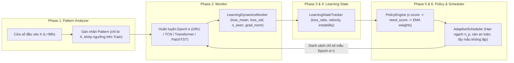

# PALF — Pattern-Aware Learning Framework

**PALF (Pattern-Aware Learning Framework)** là một khung huấn luyện thích nghi độc lập kiến trúc (*model-agnostic adaptive training framework*) dành cho bài toán dự báo chuỗi thời gian (*time-series forecasting*).

Thay vì đối xử đồng đều với mọi cửa sổ thời gian trong suốt quá trình huấn luyện (như cách lấy mẫu ngẫu nhiên truyền thống `DataLoader(shuffle=True)`), PALF tự động phân loại các cửa sổ đầu vào thành các **Pattern** có ý nghĩa vật lý, theo dõi **động lực học (Learning Dynamics)** của từng Pattern sau mỗi epoch, và điều chỉnh **tỷ lệ lấy mẫu theo Pattern (reweighting & sample budgeting)** ở các epoch tiếp theo.

---

## 1. Động lực & Bài toán (Motivation)

Trong dữ liệu chuỗi thời gian thực tế (như bộ dữ liệu khí tượng **Jena Climate 2009–2016** với `n_train = 48,981`, `n_val = 10,377`, `n_test = 10,377`):
- Trên tập test (`10,377` mẫu), trạng thái thời tiết bình thường (`normal`) chiếm **66,9%** (`6,942` mẫu), trong khi 3 nhóm biến động theo ngưỡng phân vị gồm **dị thường nhiệt độ nóng/lạnh** (`temp_anomaly`, **16,7%**, `1,730` mẫu), **sụt áp nhanh** (`pressure_drop`, **9,0%**, `929` mẫu), và **độ ẩm tăng ròng mạnh** (`humidity_net_rise`, **7,5%**, `776` mẫu).
- Khi huấn luyện đồng đều (*uniform sampling*), các mẫu `normal` áp đảo gradient và hội tụ sớm, trong khi các Pattern hiếm/biến động có tốc độ giảm lỗi và độ bất ổn khác biệt rõ rệt theo từng giai đoạn huấn luyện.
- **Mục tiêu của PALF:** Đóng vòng phản hồi tự động sau mỗi epoch để phân bổ lại ngân sách mẫu huấn luyện về các Pattern đang cần học hơn, giúp:
  1. **Cùng ngân sách mẫu ($\rho = 1.0$):** Kiểm tra khả năng cải thiện chất lượng dự báo trên các Pattern khó.
  2. **Giảm ngân sách mẫu ($\rho < 1.0$, ví dụ $\rho = 0.7$):** Duyệt ít mẫu hơn mỗi epoch (giảm thời gian huấn luyện) nhưng giữ hoặc vượt chất lượng của baseline lấy mẫu đều ở cùng ngân sách.

---

## 2. Kiến trúc 6 giai đoạn của PALF



### Chi tiết từng thành phần:
1. **Phase 1 — Pattern Analyzer (`src/palf/data/patterns_weather.py`)**:
   - Gán nhãn mỗi cửa sổ hoàn toàn dựa trên chuỗi quá khứ đầu vào $X$ ($L=96$ giờ), **tuyệt đối không nhìn chuỗi mục tiêu tương lai $Y$** ($H=24$ giờ).
   - Mọi ngưỡng phân vị và đường cơ sở theo mùa × giờ trong ngày được ước lượng **chỉ trên tập `train`**, kèm khoảng đệm `purge_gap = L + H - 1 = 119` bước giữa `train` / `val` / `test` để triệt tiêu rò rỉ cửa sổ trượt.
   - Bốn nhãn Pattern theo thứ tự ưu tiên phân cấp:
     1. `pressure_drop`: Sụt áp suất khí quyển mạnh trong 24h cuối cửa sổ.
     2. `humidity_net_rise`: Độ ẩm tương đối tăng ròng mạnh kèm mức ẩm cuối cửa sổ cao.
     3. `temp_anomaly`: Nhiệt độ lệch mạnh so với trung vị lịch sử cùng tháng & giờ (lưu kèm dấu `temp_sign = +1` cho dị thường nóng `heat` và `-1` cho dị thường lạnh `cold`).
     4. `normal`: Các cửa sổ còn lại.

2. **Phase 2 — Learning Dynamics Monitor (`src/palf/core/monitor.py`)**:
   - Ghi nhận ma trận lỗi từng mẫu qua các epoch (`sample_loss_epochs.npy` kích thước $N_{\text{train}} \times E$), số lượng mẫu thực sự được duyệt `n_seen`, độ lớn gradient (`grad_norm`) trên tập probe cố định, và bản đồ dữ liệu Dataset Cartography (`cartography.csv`).

3. **Phase 3 — Phân tích Thống kê & Kiểm định Dự báo (`src/palf/evaluation/phase3_analysis.py`)**:
   - Chuẩn hóa lỗi theo từng Pattern ở epoch đầu: $\tilde{\ell}_p(e) = \ell_p(e) / \ell_p(1)$ để khử chênh lệch thang đo biên độ tự nhiên giữa các Pattern.
   - Kiểm định Kruskal-Wallis và hiệu ứng $\epsilon^2$ trên đơn vị **đoạn sự kiện liên tiếp (*contiguous event runs*)** để tránh phóng đại cỡ mẫu giả tạo do các cửa sổ trượt chồng lấn.
   - Đối chứng với **nhóm hoán vị nhãn theo khối (*block-permutation null control*)** và kiểm định khả năng dự báo $\Delta\text{loss}(e \to e+k)$ vượt trên mô hình tự hồi quy chỉ dùng loss hiện tại.

4. **Phase 4 — Learning State Tracker (`src/palf/core/state.py`)**:
   - Tính toán trạng thái học cho từng Pattern chỉ từ thống kê **train** (chặn mọi khóa chứa `val` hoặc `test`):
     - `loss_ratio`: $\tilde{\ell}_p(e) = \ell_p(e) / \ell_p(1)$ (tỷ lệ lỗi còn lại so với epoch 1).
     - `velocity`: $(\tilde{\ell}_p(e-W) - \tilde{\ell}_p(e)) / W$ (tốc độ giảm lỗi trong cửa sổ $W$ epoch).
     - `instability`: $\text{std}(\tilde{\ell}_p(e-W+1 \dots e))$ (độ dao động của đường cong lỗi trong cửa sổ $W$).

5. **Phase 5 — Policy Engine (`src/palf/core/policy.py`, Spec v1)**:
   - Hỗ trợ các chế độ chính sách để đối chứng công bằng:
     - `uniform`: Mọi $w_p = 1.0$ (baseline đi qua Scheduler).
     - `loss`: Điểm ưu tiên chỉ dùng $z(\text{loss\_ratio})$ (đối chứng thích nghi đơn giản B2 — `A1`).
     - `predictive` (**PALF v1 — `A3` / `A3r`**): Dự báo độ giảm loss chuẩn hóa $\hat{y}_p = \text{intercept} + \sum_k \text{coef}_k \cdot x_{k,p}^{\text{std}}$ từ hệ số hồi quy tuyến tính đa biến ước lượng ngoài mẫu (`predictive_coef_gru_seeds34.json`), đặt $\text{raw\_need}_p = -\hat{y}_p$, chuẩn hóa z-score giữa các pattern $s_p(e) = z(\text{raw\_need}_p)$ và biến đổi hàm mũ sang trọng số:
       $$w_{\text{new}, p} = \text{clip}\!\left(\exp(\alpha \cdot s_p(e)),\; w_{\min},\; w_{\max}\right), \quad w_p(e) = \beta\, w_p(e-1) + (1-\beta)\, w_{\text{new}, p}$$

6. **Phase 6 — Adaptive Scheduler (`src/palf/training/scheduler.py`, Spec v1)**:
   - Với ngân sách $n_e = \text{round}(\rho \cdot n_{\text{train}})$ mẫu mỗi epoch:
     - Tính tỷ lệ mục tiêu $q_p \propto w_p \cdot \pi_p$ (với $\pi_p = N_p / n_{\text{train}}$).
     - Bảo đảm sàn tối thiểu $n_{\text{floor}} = \min(N_p, \max(32, \text{round}(0.05 \cdot \pi_p \cdot n_e)))$ để không Pattern hiếm nào bị mất tín hiệu, và phân bổ phần dư lớn nhất trên toàn bộ các nhóm có $N_p > 0$ (không cắt trần ở $N_p$) để $\sum_p n_p = n_e$.
     - Khi $n_p \le N_p$: lấy ngẫu nhiên $n_p$ mẫu **không hoàn lại**.
     - Khi $n_p > N_p$ (nhóm khó được tăng trọng số $w_p > 1$): lấy toàn bộ $N_p$ mẫu gốc đúng 1 lần cộng thêm $n_p - N_p$ mẫu lấy **có hoàn lại**, sau đó gộp và xáo trộn toàn cục.

---

## 3. Các kiến trúc Backbone được hỗ trợ

PALF tách biệt hoàn toàn với kiến trúc mạng dự báo. Dự án tích hợp sẵn 4 họ kiến trúc tiêu biểu trong [`src/palf/models/`](file:///d:/Github/PALF/src/palf/models/__init__.py):

| Tên Backbone | Mã CLI (`--model`) | Họ kiến trúc | Đặc trưng chính |
|---|---|---|---|
| **GRU** | `gru` | Recurrent (RNN) | Mạng hồi quy có cổng 2 tầng, xử lý tuần tự theo bước thời gian |
| **TCN** | `tcn` | Convolutional | Mạng tích chập nhân quả giãn nở (*dilated causal convolution*) kèm kết nối tắt |
| **Transformer** | `transformer` | Attention (Step-wise) | Mã hóa vị trí + Multi-Head Self-Attention trên từng bước thời gian |
| **PatchTST** | `patchtst` | Patch-based Transformer | Chia chuỗi thành các đoạn ngắn (*patches*) trước khi đưa vào Transformer |

---

## 4. Cấu trúc thư mục dự án

```text
PALF/
├── app/
│   └── app.py                          # Giao diện Demo Streamlit (3 trang: So sánh, Quan sát PALF, Train trực tiếp)
├── data/
│   └── raw/                            # Thư mục tự động tải dữ liệu Jena Climate 2009-2016
├── experiments/
│   ├── analysis/
│   │   ├── phase3_real/                # Báo cáo & CSV phân tích Phase 3 trên 20 run Baseline thật (G3)
│   │   └── comparison/                 # Báo cáo, CSV & biểu đồ so sánh Baseline vs PALF (Mục 7)
│   ├── results/
│   │   ├── baseline/jena/              # Kết quả chạy Baseline A0 (<model>/seed<k>/)
│   │   └── palf/jena/                  # Kết quả chạy PALF (<config_tag>/<model>/seed<k>/)
│   └── scripts/
│       ├── run_observation.py          # CLI huấn luyện Baseline & PALF trên Jena / Synthetic
│       ├── analyze_phase3.py           # CLI chạy phân tích thống kê Phase 3
│       ├── compare_runs.py             # CLI chạy giao thức so sánh công bằng Mục 7 (A0, A0r, A1, A2, A2r)
│       └── run_pattern_audit.py        # CLI kiểm toán chất lượng Pattern Analyzer v1
├── src/palf/
│   ├── core/
│   │   ├── config.py                   # Lớp cấu hình trung tâm PalfConfig
│   │   ├── monitor.py                  # LearningDynamicsMonitor & Dataset Cartography
│   │   ├── state.py                    # LearningStateTracker (chỉ nhận tín hiệu train)
│   │   └── policy.py                   # PolicyEngine & PolicyDecision (uniform, loss, state)
│   ├── data/
│   │   ├── pattern_features.py         # Tiền xử lý chuỗi giờ & chia tập train/val/test có purge gap
│   │   ├── patterns_weather.py         # Pattern Analyzer v1 (4 nhãn thời tiết + temp_sign)
│   │   ├── weather.py                  # DataLoader cho Jena Climate
│   │   └── synthetic.py                # Bộ sinh dữ liệu chuỗi thời gian giả lập có kiểm soát
│   ├── evaluation/
│   │   ├── phase3_analysis.py          # Công cụ kiểm định thống kê & dự báo Phase 3
│   │   ├── demo_loader.py              # Bộ đọc và tổng hợp dữ liệu cho giao diện Demo
│   │   └── compare_runs.py             # Bộ tổng hợp giao thức so sánh công bằng Mục 7
│   ├── models/                         # Định nghĩa 4 mô hình: GRU, TCN, Transformer, PatchTST
│   └── training/
│       ├── scheduler.py                # AdaptiveScheduler v1 (hỗ trợ lặp mẫu có hoàn lại khi n_p > N_p)
│       └── trainer.py                  # Vòng lặp huấn luyện hợp nhất (mode="baseline" | "palf")
└── tests/                              # 77 bài kiểm thử tự động (pytest)
```

---

## 5. Kết quả Thực nghiệm trên Tập Jena Climate (`GRU`, 3 Seed & 5 Seed — Prompt 8)

Bảng tổng hợp từ [`experiments/analysis/comparison/comparison_report.md`](file:///d:/Github/PALF/experiments/analysis/comparison/comparison_report.md) (`n_train = 48,981`, `n_val = 10,377`, `n_test = 10,377`, `epochs = 30`, `batch = 128`, `lr = 1e-3`):

> **Nhận xét quan trọng (kết luận trung thực):**
> 1. **Trên cả 3 seed (`0, 1, 2`) và 5 seed (`0, 1, 2, 3, 4`):** Chênh lệch Test MAE tổng thể giữa mọi cấu hình đều **nằm trong phạm vi biến động giữa các seed**. Trên 5 seed, hiệu số ghép `A3 - A1 = +0.0063 ± 0.0148 °C` và `A3r - A0r = +0.0021 ± 0.0043 °C`. Cấu hình `A0r` (chỉ giảm 30% mẫu ngẫu nhiên mỗi epoch, không phân biệt Pattern) và `A1` (chỉ dùng `loss_ratio`) đạt MAE tổng thể tương đương `A3`/`A3r`.
> 2. **Định danh G3:** Tiêu chí G3 đặt trước cho kết quả **"lui về phương án dự phòng"** (chỉ 2/4 backbone đạt $\Delta R^2 \ge 0.02$ sau kiểm soát epoch và dấu $\beta$ không cùng chiều ở PatchTST), nên `A3` và `A3r` được gọi đúng tên là **`predictive (không đạt ngưỡng G3)`**.
> 3. **Hai thí nghiệm khám phá đặt trước (`E1: warmup_epochs=1`, `E2: policy=loss_abs` trên `seeds 0, 1, 2`):** Cả `E1` (`1.7873 ± 0.0247 °C`) và `E2` (`1.7756 ± 0.0224 °C`) đều không vượt qua đối chứng `A0r`/`A1`/`A3` và được giữ nguyên đầy đủ trong báo cáo.

### 5.1. Bảng 5 Seed hoàn chỉnh (`seeds 0, 1, 2, 3, 4`) & Trung bình 4 Seed độc lập (`seeds 1..4`)

| Mã | Cấu hình (`config_tag`) | Test MAE (°C) 5 seed (`0..4`) ↓ | Test MAE (°C) 4 seed (`1..4`) ↓ | Test RMSE (°C) 5 seed ↓ | Best Val Loss 5 seed ↓ | Best Epoch | MAE `pressure_drop` (°C) ↓ | MAE `temp_anomaly_cold` (°C) ↓ |
| :--- | :--- | :---: | :---: | :---: | :---: | :---: | :---: | :---: |
| **`A0`** | `baseline` (`uniform, b=1.0`) | `1.7836 ± 0.0255` | `1.7872 ± 0.0280` | `2.3446 ± 0.0326` | `0.0809 ± 0.0017` | `5.6` | `1.7223 ± 0.0537` | `2.5131 ± 0.2079` *(3s)* |
| **`A0r`** | `uniform_b0.7` (`uniform, b=0.7`) | `1.7678 ± 0.0118` | `1.7683 ± 0.0135` | `2.3331 ± 0.0148` | `0.0805 ± 0.0009` | `6.4` | `1.6969 ± 0.0333` | `2.5505 ± 0.1456` |
| **`A1`** | `loss_b1.0_a1.0` (`loss_only, b=1.0`) | **`1.7618 ± 0.0238`** | **`1.7621 ± 0.0275`** | `2.3321 ± 0.0312` | `0.0811 ± 0.0019` | `5.8` | `1.6893 ± 0.0313` | `2.5612 ± 0.2162` |
| **`A3`** | `predictive_b1.0_a0.5_w2` *(không đạt ngưỡng G3)* | `1.7682 ± 0.0124` | `1.7707 ± 0.0128` | **`2.3308 ± 0.0140`** | `0.0801 ± 0.0015` | `5.2` | `1.6889 ± 0.0339` | `2.4060 ± 0.0622` |
| **`A3r`** | `predictive_b0.7_a0.5_w2` *(không đạt ngưỡng G3)* | `1.7699 ± 0.0118` | `1.7709 ± 0.0134` | `2.3323 ± 0.0120` | **`0.0799 ± 0.0013`** | `6.2` | **`1.6855 ± 0.0283`** | **`2.4016 ± 0.0709`** |

### 5.2. Bảng 3 Seed gốc (`seeds 0, 1, 2`) & Hai thí nghiệm khám phá (`E1`, `E2`)

| Mã | Cấu hình (`config_tag`) | Số seed | Test MAE (°C) ↓ | Test RMSE (°C) ↓ | Best Val Loss ↓ | Best Epoch | MAE `pressure_drop` (°C) ↓ | MAE `temp_anomaly_cold` (°C) ↓ |
| :--- | :--- | :---: | :---: | :---: | :---: | :---: | :---: | :---: |
| **`A0`** | `baseline` (`uniform, b=1.0`) | `3 (0,1,2)` | `1.7872 ± 0.0335` | `2.3517 ± 0.0411` | `0.0818 ± 0.0003` | `5.7` | `1.7411 ± 0.0599` | `2.5131 ± 0.2079` |
| **`A0r`** | `uniform_b0.7` (`uniform, b=0.7`) | `3 (0,1,2)` | **`1.7692 ± 0.0111`** | `2.3334 ± 0.0173` | `0.0808 ± 0.0005` | `6.0` | `1.7006 ± 0.0399` | `2.5354 ± 0.1950` |
| **`A1`** | `loss_b1.0_a1.0` (`loss_only, b=1.0`) | `3 (0,1,2)` | `1.7734 ± 0.0246` | `2.3392 ± 0.0371` | `0.0814 ± 0.0020` | `5.7` | `1.6926 ± 0.0435` | `2.5206 ± 0.2445` |
| **`A3`** | `predictive_b1.0_a0.5_w2` *(không đạt ngưỡng G3)* | `3 (0,1,2)` | `1.7704 ± 0.0156` | **`2.3309 ± 0.0195`** | `0.0802 ± 0.0020` | `5.3` | **`1.6881 ± 0.0418`** | **`2.3760 ± 0.0660`** |
| **`A3r`** | `predictive_b0.7_a0.5_w2` *(không đạt ngưỡng G3)* | `3 (0,1,2)` | `1.7701 ± 0.0071` | `2.3319 ± 0.0114` | **`0.0801 ± 0.0008`** | `6.3` | `1.6930 ± 0.0255` | `2.3918 ± 0.0638` |
| **`E1`** | `e1_warmup1_b1.0_a0.5_w2` *(khám phá: `warmup=1`)* | `3 (0,1,2)` | `1.7873 ± 0.0247` | `2.3577 ± 0.0204` | `0.0811 ± 0.0013` | `6.0` | `1.7177 ± 0.0261` | `2.4786 ± 0.1111` |
| **`E2`** | `loss_abs_b1.0_a0.5_w2` *(khám phá: `loss_abs`)* | `3 (0,1,2)` | `1.7756 ± 0.0224` | `2.3417 ± 0.0280` | `0.0816 ± 0.0017` | `4.3` | `1.7013 ± 0.0377` | `2.4945 ± 0.1244` |

---

## 6. Hướng dẫn cài đặt & Sử dụng nhanh (PowerShell)

### 6.1. Cài đặt môi trường
```powershell
python -m venv .venv
.\.venv\Scripts\Activate.ps1
pip install -e .
pip install pytest
```

### 6.2. Chạy bộ kiểm thử tự động (`pytest`)
Toàn bộ 77 bài kiểm thử kiểm tra từ chống rò rỉ dữ liệu, tính tất định của Pattern Analyzer, Monitor, Phase 3, Policy, Scheduler v1 đến giao thức so sánh:
```powershell
.\.venv\Scripts\python.exe -m pytest -q
```

### 6.3. Mở giao diện Demo trực quan (Streamlit)
Giao diện gồm 3 trang (xem kịch bản trình diễn tại [`experiments/DEMO_SCRIPT.md`](file:///d:/Github/PALF/experiments/DEMO_SCRIPT.md)):
1. **So sánh cạnh nhau (Ngoại tuyến - Kết quả chạy sẵn 30 epoch):** Đặt 2–3 lần chạy sẵn trên đĩa cạnh nhau, vẽ đường `val_loss` theo **epoch**, **số mẫu tích lũy** và **thời gian tích lũy**, bảng MAE/RMSE (°C) tổng và theo từng Pattern (`Mean ± Std` qua các seed).
2. **Quan sát PALF:** Hiển thị trọng số `weights[p]`, tỷ lệ mẫu lịch trình (`quota_planned` share), tỷ lệ mẫu duy nhất (`n_seen` share) và các biến Learning State theo từng epoch.
3. **CHẠY THU NHỎ (SMOKE / DEMO TRỰC TIẾP):** Chạy thử nghiệm nhanh trên tập con dữ liệu, lưu tách biệt vào `experiments/results/smoke/`.

```powershell
.\.venv\Scripts\python.exe -m streamlit run app\app.py
```

### 6.4. Chạy huấn luyện qua CLI (`run_observation.py`)
5 cấu hình tiêu chuẩn trong giao thức thực nghiệm (chi tiết trong [`experiments/RUNS.md`](file:///d:/Github/PALF/experiments/RUNS.md)):
- **A0 (Baseline đầy đủ, $\rho=1.0$):**
  ```powershell
  .\.venv\Scripts\python.exe experiments\scripts\run_observation.py --model gru --mode baseline --seeds 0,1,2,3,4 --epochs 30
  ```
- **A0r (Đối chứng lấy mẫu đều qua Scheduler ở ngân sách giảm $\rho=0.7$):**
  ```powershell
  .\.venv\Scripts\python.exe experiments\scripts\run_observation.py --model gru --mode palf --policy uniform --budget-ratio 0.7 --seeds 0,1,2 --epochs 30
  ```
- **A1 (Đối chứng thích nghi chỉ dùng `loss_ratio`, $\rho=1.0$):**
  ```powershell
  .\.venv\Scripts\python.exe experiments\scripts\run_observation.py --model gru --mode palf --policy loss --budget-ratio 1.0 --alpha 1.0 --w-max 3.0 --seeds 0,1,2 --epochs 30
  ```
- **A3 (PALF `predictive` Learning State, cùng ngân sách $\rho=1.0$):**
  ```powershell
  .\.venv\Scripts\python.exe experiments\scripts\run_observation.py --model gru --mode palf --policy predictive --predictive-coef experiments\analysis\phase3_real\predictive_coef_gru_seeds34.json --budget-ratio 1.0 --alpha 0.5 --w-max 2.0 --seeds 0,1,2 --epochs 30
  ```
- **A3r (PALF `predictive` Learning State, giảm ngân sách $\rho=0.7$):**
  ```powershell
  .\.venv\Scripts\python.exe experiments\scripts\run_observation.py --model gru --mode palf --policy predictive --predictive-coef experiments\analysis\phase3_real\predictive_coef_gru_seeds34.json --budget-ratio 0.7 --alpha 0.5 --w-max 2.0 --seeds 0,1,2 --epochs 30
  ```
*(Mẹo: Khi thêm `--subset 2048 --epochs 10`, kết quả sẽ tự động được tách sang `experiments/results/smoke/`).*

### 6.5. Chạy phân tích Phase 3 (kèm G3 Follow-up) và tổng hợp so sánh Mục 7
- **Phân tích Phase 3 & Kiểm định G3 trên log Baseline thật:**
  ```powershell
  .\.venv\Scripts\python.exe experiments\scripts\analyze_phase3.py --in-dir experiments\results\baseline\jena --out-dir experiments\analysis\phase3_real --g3-followup
  ```
- **So sánh các cấu hình Baseline vs PALF (`A0, A0r, A1, A3, A3r`):**
  ```powershell
  .\.venv\Scripts\python.exe experiments\scripts\compare_runs.py --models gru --seeds 0,1,2 --out-dir experiments\analysis\comparison
  ```

---

## 7. Nguyên tắc thực nghiệm bất biến (Experimental Integrity)

1. **Không rò rỉ tương lai hay tập đánh giá:**
   - Gán nhãn Pattern chỉ dùng cửa sổ quá khứ $X$, mọi thống kê chuẩn hóa và ngưỡng phân vị chỉ khớp trên `train`.
   - `LearningStateTracker` và `PolicyEngine` chỉ nhận thống kê từ tập `train`; tập `val` chỉ dùng để chọn checkpoint và tính ngưỡng hội tụ; tập `test` chỉ đánh giá một lần ở cuối.
2. **Đơn vị đo lường có ý nghĩa vật lý:**
   - Bên cạnh MSE/MAE/RMSE trên miền chuẩn hóa, mọi báo cáo và giao diện đều quy đổi sang đơn vị thực tế **độ C (°C)** tổng thể và tách theo từng Pattern (bao gồm cả tách `temp_anomaly` thành `temp_anomaly_heat` và `temp_anomaly_cold`).
3. **Trung thực thống kê:**
   - Đối chứng giảm ngân sách (`A2r`) luôn phải so trực tiếp với baseline lấy mẫu đều ở **cùng ngân sách** (`A0r`), không chỉ so với `A0`.
   - Với các cấu hình có ít hơn 5 seed, báo cáo chỉ mô tả xu hướng và hiệu số ghép theo từng seed (*paired seed differences*), không tuyên bố ý nghĩa thống kê.
